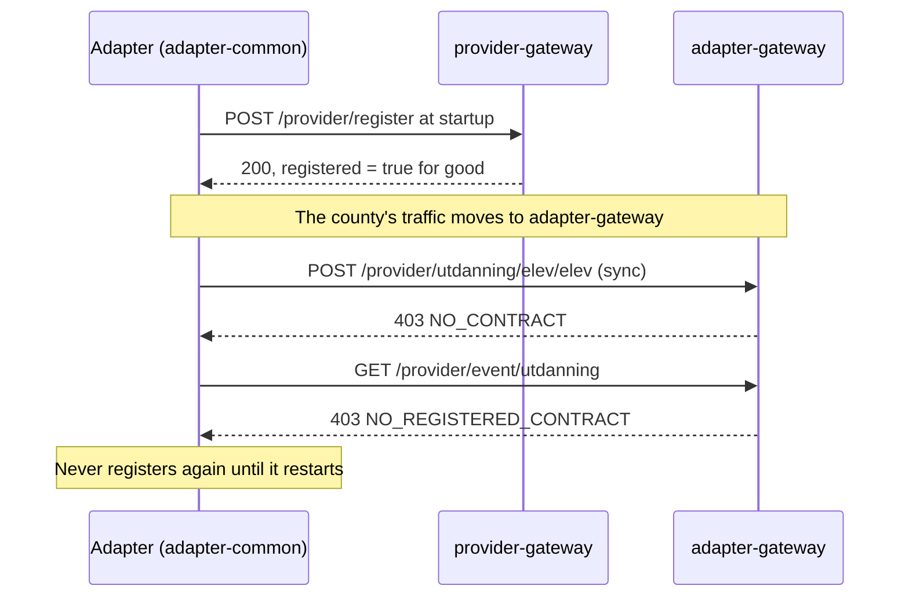

# PRD: Registration that accepts what provider-gateway accepts

| | |
|---|---|
| Status | Implemented, with infra-models 3.4.2 |
| Date | 2026-10-19 |
| Scope | `POST /provider/register` in adapter-gateway |
| Background | [README.md](README.md) |

## Problem

An adapter registers with `POST /provider/register` when it starts. provider-gateway accepts almost any contract with
the right org and username. adapter-gateway validates the body against the infra-models annotations and two rules
of its own, so some contracts that work in prod today get `400`.

A rejected registration is worse than one failed request. fint-core-adapter-common keeps retrying registration on every
heartbeat tick and sends no heartbeats until registration succeeds. The adapter has no contract, so every sync and every
event is refused as well.

## Goal

Every contract that provider-gateway accepts in prod is accepted by adapter-gateway, stored, and published to the
contract topic, without a change on the adapter side.

## Non-goals

- Sync, events and heartbeat. They get their own PRDs, but [cutover](#cutover-contracts-that-never-arrive) explains
  the decision that is passed on to them.
- Routing between counties and `ORG_NOT_SERVED`.
- Making anything stricter than it is today.
- What goes inside `eventCapabilities`. The field is new and no old adapter fills it, so its entries stay validated.
  Only a missing or `null` list must be accepted, see C5.

## Who depends on a registration

| Consumer                               | What it reads                                                     |
|----------------------------------------|-------------------------------------------------------------------|
| Sync authorization in adapter-gateway  | the contract for the username and org, and its `capabilities`     |
| Event authorization in adapter-gateway | the contract for the username and org, and its `eventCapabilities` |
| client-api, through `/internal/event-capabilities` | the `eventCapabilities` of every contract for the org |
| status-service, through the contract topic | `adapterId`, `orgId`, `username`, `heartbeatIntervalInMinutes`, and each capability |

status-service reads the contract topic into a Kotlin class where `adapterId` cannot be null. A contract published with
`adapterId: null` cannot be read there. It is skipped with a warning and the adapter does not show up in
status-service. A heartbeat interval below 1 is read as 1 there, and any larger value is fine.

## Changes

### C1. Accept any `heartbeatIntervalInMinutes`

|                    |                                                                                          |
|--------------------|------------------------------------------------------------------------------------------|
| provider-gateway   | Accepts any value.                                                                       |
| adapter-gateway before | `400` outside 1–5, from `@Min(1) @Max(5)` in infra-models.                               |
| Who breaks         | Any adapter configured with an interval above 5 minutes. adapter-common has no default, so the value comes from each adapter's config. |
| Proposal           | Stop checking the range on registration, the same way `deltaSyncInterval` is lifted in `ContractConstraints`. Store and publish the value as sent. No log: status-service shows the interval every adapter registered. |
| Alternative        | Clamp to 1–5 before storing. It hides what the adapter actually does, and status-service would raise false alarms for an adapter that beats every 10 minutes. |
| Downstream         | Nothing breaks. status-service reads a value below 1 as 1.                               |
| Decision           | Agreed on 2026-10-19.                                                                    |

### C2. Accept a missing or blank `adapterId`

|                    |                                                                                          |
|--------------------|------------------------------------------------------------------------------------------|
| provider-gateway   | Accepts it. It stores and publishes `null` or `""`.                                       |
| adapter-gateway before | `400`, from `@NotBlank`.                                                                  |
| Who breaks         | An adapter without `fint.adapter.id` configured.                                          |
| Proposal           | Stop checking it. When it is missing or blank, store and publish the username as `adapterId`. No log: status-service shows the adapter id of every contract. |
| Why not just accept `null` | status-service skips a contract whose `adapterId` is `null`, so the adapter would disappear from status-service. |
| Alternative        | Use `""` instead of the username. status-service reads it, but it shows an empty adapter id and search cannot find it. |
| Downstream         | In status-service, an adapter that sent no id is one whose adapter id equals its username. |
| Decision           | The username, agreed on 2026-10-19.                                                       |

### C3. Accept the same resource listed twice in `capabilities`

|                    |                                                                                          |
|--------------------|------------------------------------------------------------------------------------------|
| provider-gateway   | Accepts it and stores both entries.                                                       |
| adapter-gateway before | `400` from `ListedOnce`, which ignores case. `AdapterCapability` has no `equals`, so even two identical entries count as two. |
| Who breaks         | An adapter that names one resource under two keys in its capability config.              |
| Proposal           | Accept the list and keep one entry per resource, ignoring case. When the entries differ, keep the one with the shortest `fullSyncIntervalInDays`, because that is the strictest promise and the one status-service should hold it to. Log a warning. Store and publish the merged list. |
| Alternative        | Keep the first entry. The list is read into a `HashSet`, so "first" does not follow the order in the JSON and the result would be random. |
| Not changed        | `ListedOnce` stays on `eventCapabilities`.                                                |
| Downstream         | status-service already keeps one row per resource, so it gets the same result, just decided in one place. |
| Decision           | Agreed on 2026-10-19.                                                                    |

### C4. Accept `"heartbeatIntervalInMinutes": null`, and keep Jackson 3's defaults

|                    |                                                                                          |
|--------------------|------------------------------------------------------------------------------------------|
| provider-gateway   | Jackson 2 reads `null` as `0`, and stores and publishes `0`.                              |
| adapter-gateway before | With infra-models 3.4.0, Jackson 3 refuses it with `400`, because the field is an `int` and `FAIL_ON_NULL_FOR_PRIMITIVES` is on by default. |
| Who breaks         | An adapter not built on infra-models that writes `null` for an unset field.               |
| Change             | infra-models 3.4.1 makes `heartbeatIntervalInMinutes` an `Integer`, so Jackson 3 reads `null` as `null` with its defaults unchanged. adapter-gateway uses 3.4.2, and `RegistrationService` turns a `null` into `0` before the contract is published and saved, which is what provider-gateway published. |
| Why `0` and not `null` downstream | The database column is `not null`. status-service reads the interval as a non-null Kotlin `Int` with Jackson 3, so it would skip a contract with `null` and the adapter would disappear from it. It reads `0` as 1. |
| `time`             | infra-models 3.4.2 ([#17](https://github.com/FINTLabs/fint-core-infra-models/pull/17)) makes it a `Long` the same way, so `"time": null` reads as `null`. FINT does not read it, so the gateway needs nothing beyond the bump. |
| adapter-common     | 0.1.7 is compiled against the builder's `heartbeatIntervalInMinutes(int)` and `time(long)`, so an adapter that bumps infra-models to 3.4.1 or later without a new adapter-common fails at startup. Accepted on 2026-10-19: no adapter has to bump. |
| Not needed         | `fullSyncIntervalInDays: null` is already `400` on both gateways: provider-gateway reads it as `0`, which fails 1–7. |
| Scope note         | Sync, events and heartbeat have old number and boolean fields too (`SyncPageMetadata`, `ResponseFintEvent`, `AdapterHeartbeat`). Their PRDs can use the same approach: a wrapper type in infra-models. |

### C5. Accept `eventCapabilities: null`

|                    |                                                                                          |
|--------------------|------------------------------------------------------------------------------------------|
| provider-gateway   | Does not know the field, so it ignores it.                                               |
| adapter-gateway before | A missing field becomes an empty list, which is fine. An explicit `null` is `400` from `@NotNull`. If only the check were removed, `null` would reach the database code and fail with a 500. |
| Who breaks         | An adapter that writes `null` for fields it does not set. The field is new, so refusing it is a breaking change. |
| Change             | In infra-models 3.4.2 ([#17](https://github.com/FINTLabs/fint-core-infra-models/pull/17)), `setEventCapabilities(null)` sets an empty set. Jackson calls the setter, so `null` reads as `[]` with Jackson 3's defaults, `@NotNull` passes, and the stored and published contract looks the same as one without the field. The gateway only bumps infra-models. |
| Alternative        | Lift `@NotNull` in `ContractConstraints` and turn `null` into an empty list in `RegistrationService`. Not chosen: the fix belongs in the model. |
| Not changed        | The entries are still validated: known resource, names not blank, at least one operation, and each resource listed once. |
| Decision           | infra-models, agreed on 2026-10-19.                                                      |

### Kept as they are

These rules differ from provider-gateway, but only on requests that fail on both, or the difference does not hurt an
adapter.

| Rule                                      | provider-gateway   | adapter-gateway | Why keep it                                    |
|-------------------------------------------|--------------------|-----------------|------------------------------------------------|
| `capabilities` missing                    | 500                | 400             | It fails on both. 400 is the right answer.      |
| `orgId` or `username` blank               | 403 or 500         | 400             | It fails on both.                               |
| Body checked before org and username      | org and username first | body first  | Only changes which error a request gets when it fails both. |
| Error body                                | plain text         | `application/problem+json` | adapter-common reads only the status code. The new body tells the adapter which field is wrong. |
| Resource must exist in the FINT model     | 400                | 400             | Same set of concrete resources in both models.  |
| `fullSyncIntervalInDays` 1–7              | 400                | 400             | Same rule.                                      |
| `deltaSyncInterval` optional              | accepted           | accepted        | Already lifted in #125.                         |
| Entries in `eventCapabilities` validated  | not in the model   | 400             | New field. No old adapter fills it.             |

## Cutover: contracts that never arrive

This is the biggest registration risk, and changing validation does not solve it.



| Option | What it takes | Verdict |
|--------|---------------|---------|
| A. Restart every adapter of the county at cutover | Coordination per county and per vendor | Works, but is fragile and depends on others |
| B. Sync and events tolerate a missing contract, as provider-gateway does | A decision in the sync and events PRDs | Removes the risk. Recommended |
| C. Seed contracts from provider-gateway's `adapter-register` topic | A one-off import job | The topic keeps 1 day by default, so most adapters are missing |
| D. Seed from provider-gateway's contract table | A one-off import job | The table is recreated on every provider restart, so it holds only adapters that started after that |
| E. adapter-common registers again on a `403` with type `.../no-contract`, or on a timer | A release of adapter-common, then every adapter upgrades | Good for the future, too slow for this cutover |

Recommendation: B for the cutover, E as follow-up work. The registration side needs nothing for B. Registering again is
already an upsert on username and org.

## Success criteria

- A contract that provider-gateway accepts gets `200` from adapter-gateway, is stored, and shows up in status-service.
- A contract that provider-gateway rejects is still rejected: a resource not in the model, a full sync interval outside
  1–7, the wrong org, or the wrong username.
- Duplicates merged under C3 log one warning with username, org and resource. C1 and C2 are not logged, since
  status-service shows the heartbeat interval and adapter id of every contract.

## Implementation

- `ContractConstraints` ignores the infra-models annotations on `heartbeatIntervalInMinutes` and `adapterId` (C1, C2),
  and puts `ListedOnce` on `eventCapabilities` only (C3).
- `RegistrationService` sets a `null` heartbeat to `0`, puts the username in for a missing adapter id, and keeps one
  capability per resource, before the contract is published and saved (C2, C3, C4). The contract topic and the
  database therefore hold the same contract.
- infra-models 3.4.2 reads `null` for `heartbeatIntervalInMinutes`, `time` and `eventCapabilities` with Jackson 3's
  defaults (C4, C5). `spring.jackson.*` is unchanged.
- Tests: `ContractConstraintsTest` for the lifted rules, `RegistrationServiceTest` for what is published and saved, and
  `ContractRegistrationIT` posts a contract that provider-gateway accepted, with every relaxed rule and explicit
  `null`s, and checks what is stored.

## Open questions

1. **What do prod adapters actually send?** provider-gateway's contract table holds only the adapters registered since
   its last restart, but it is the best sample there is. Read-only queries:

   ```sql
   -- C1 and C2
   select user_name, org_id, adapter_id, heartbeat_interval_in_minutes
   from contract
   where heartbeat_interval_in_minutes not between 1 and 5
      or adapter_id is null or trim(adapter_id) = '';

   -- C3
   select user_name, lower(domain_name || '/' || pkg_name || '/' || resource_name) as resource, count(*)
   from capabilities
   group by 1, 2
   having count(*) > 1;
   ```

2. **Are there adapters in prod that are not built on fint-core-adapter-common?** They are the ones C4 and C5 are for,
   and the only ones that might send unusual JSON.
