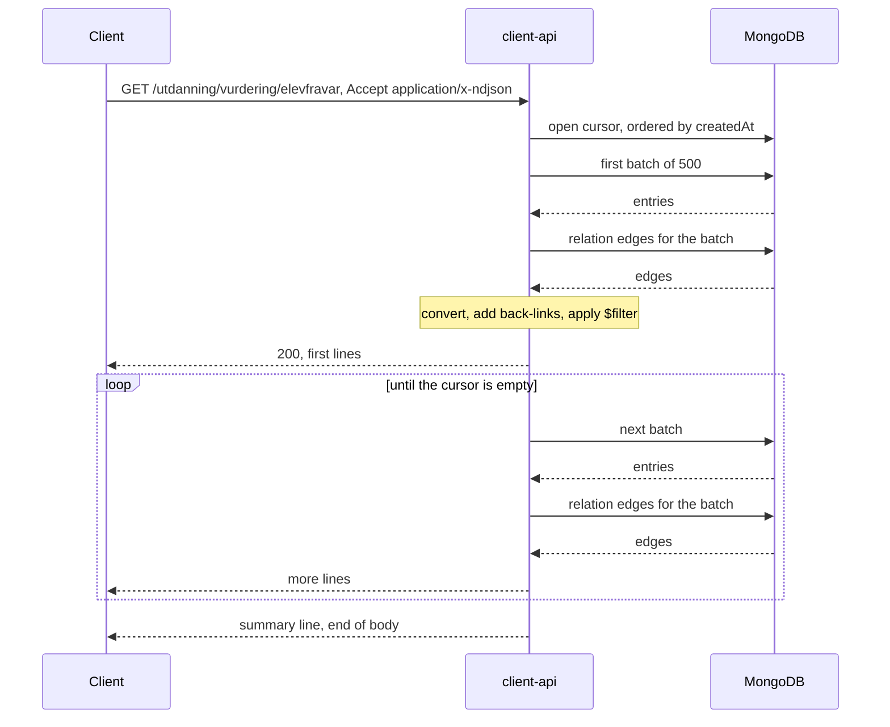

# List reads

A list read is `GET /utdanning/vurdering/elevfravar`, or the same with a `$filter` through `POST .../$query`. The
client-api answers it from the cache, which the adapters fill through syncs. There are three kinds, and the request
decides which one it gets.

| Kind                 | Request                                           | What the client gets                                                       |
|----------------------|---------------------------------------------------|----------------------------------------------------------------------------|
| A page               | `size` above zero                                 | `size` entries, with `self`, `prev` and `next` links to move through them. |
| A full read          | no `size`, or `size=0`                            | Every entry of the collection, in one JSON response.                       |
| A streamed full read | no `size`, and `Accept: application/x-ndjson`     | Every entry of the collection, one per line, sent while it is read.        |

All three accept `sinceTimeStamp`, which keeps only the entries modified at or after it, and `$filter`, an OData
expression evaluated on each entry. A page and a full read come in the same JSON shape.

```json
{
  "offset": 0,
  "total_items": 12345,
  "_embedded": { "_entries": [ ... ] },
  "_links": { "self": [ { "href": "..." } ] },
  "size": 12345
}
```

`total_items` is how many entries matched before `$filter`. `size` is how many entries the response holds.

## A page

One query reads `size + 1` entries through the `created_at_id` index, so every page is in `createdAt` order and the
extra entry says whether there is a `next`. A `cursor` in the link lets the next page start where this one ended
instead of skipping `offset` entries. The page's back-links come from one lookup of the relation edges that point
at the page's identifiers. Which relations get a back-link is listed in [RELATION_RULES.md](../RELATION_RULES.md).

## A full read

The client-api reads the collection through a Mongo cursor in batches of 500. Each batch is converted, gets its
back-links and is filtered before the next one is fetched. So the stored entries and the relation edges are in
memory one batch at a time.

The resources themselves are all kept until the body is written. Memory for a full read grows with the collection.
In return nothing is sent before the whole answer is ready, so a failure always gets a proper error status.

A client with a large collection should page, or ask for the stream.

## A streamed full read

Streaming is optional. A client asks for it with the `Accept` header.

```http
GET /utdanning/vurdering/elevfravar
Accept: application/x-ndjson
```

```http
HTTP/1.1 200 OK
Content-Type: application/x-ndjson
Transfer-Encoding: chunked

{"systemId":{"identifikatorverdi":"1"},"_links":{"self":[{"href":"..."}]}}
{"systemId":{"identifikatorverdi":"2"},"_links":{"self":[{"href":"..."}]}}
{"total_items":2,"size":2,"_links":{"self":[{"href":"..."}]}}
```

The body is [NDJSON](https://github.com/ndjson/ndjson-spec), which is one JSON object per line.

- Every line but the last is one resource. It is the same JSON as an entry of `_entries` in a full read.
- The last line is the summary. It has `total_items`, `size` and the `self` link, and it is the only line with
  `total_items`.

A client must check that the summary line came. A body without it was cut off and must be read again.

The rules for who gets a stream are simple.

- The `Accept` header must name `application/x-ndjson`. A wildcard such as `*/*` does not count, so a client that
  does not ask keeps getting JSON.
- Only a read without `size` is streamed. A page stays JSON. A client that asks for a page and accepts nothing but
  NDJSON gets `406`.
- `sinceTimeStamp`, `$filter` and `POST .../$query` work as they do for a full read.



One batch is in memory at a time, so a streamed read costs the same few megabytes whether the collection has 500
entries or 5 million.

### When something goes wrong

The writer reads the first batch, adds its back-links and runs the filter before it writes a byte. So the usual
failures still get a proper status.

| Failure                                                   | Status             |
|-----------------------------------------------------------|--------------------|
| `$filter` with bad syntax, or one that fails to evaluate  | 400                |
| Missing `x-org-id`                                        | 400                |
| Not allowed by the token or OPA                           | 401 or 403         |
| Mongo unreachable, cursor cannot open, first batch fails  | 500                |

Once the first batch is written the status is `200` and on the wire. If a later batch fails, the status cannot
change. The writer stops where it is and the summary line never comes. Tomcat still finishes the chunked encoding,
so the client's read succeeds. The missing summary line is what gives the failure away.

The writer logs the failure at error level and counts it in `fint.client.list.stream.aborted`. The gauge
`fint.client.list.stream.active` shows how many streamed reads are in flight. A client that disconnects during a
read is not a failure. It is logged at debug and nothing is counted.

### Further reading

- [NDJSON specification](https://github.com/ndjson/ndjson-spec). It defines the format and the media type
  `application/x-ndjson`. The summary line is our own addition, the specification has no end marker.
- [RFC 9110, section 12.5.1](https://www.rfc-editor.org/rfc/rfc9110.html#section-12.5.1). It defines the `Accept`
  header, which is how a client states the media types it wants.
