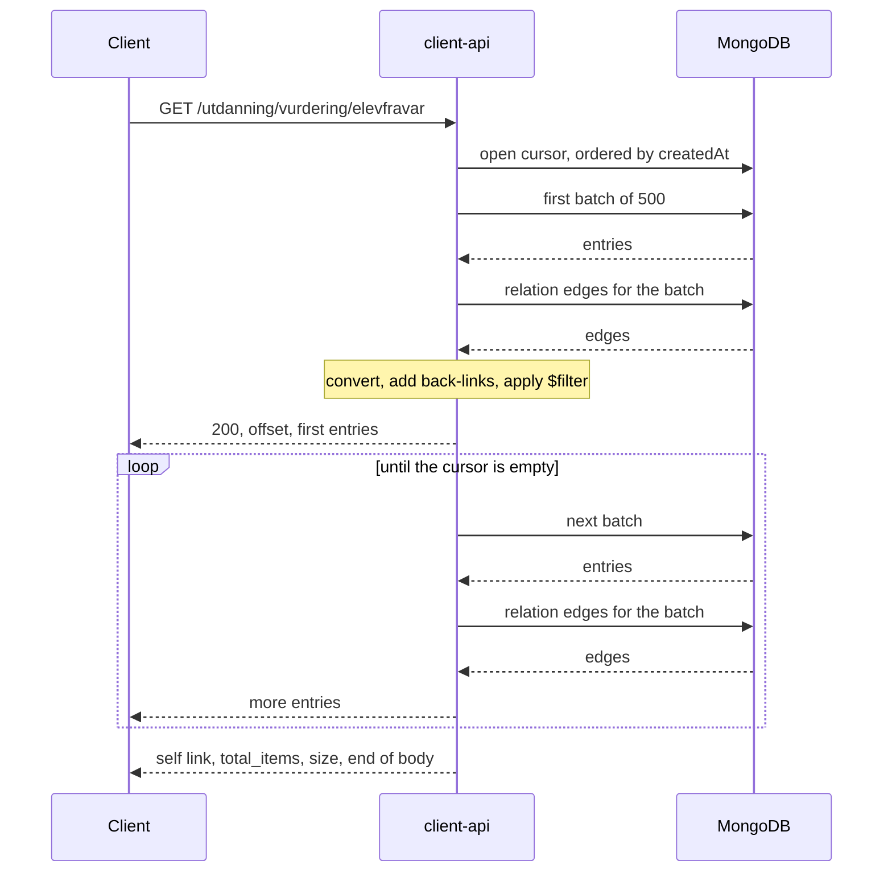

# List reads

A list read is `GET /utdanning/vurdering/elevfravar`, or the same with a `$filter` through `POST .../$query`. The
client-api answers it from the cache, which the adapters fill through syncs. There are two kinds, and the request
decides which one it gets.

| Kind    | Request                      | What the client gets                                                       |
|---------|------------------------------|----------------------------------------------------------------------------|
| A page  | `size` above zero            | `size` entries, with `self`, `prev` and `next` links to move through them. |
| A full read | no `size`, or `size=0`       | Every entry of the collection, in one response.                            |

Both accept `sinceTimeStamp`, which keeps only the entries modified at or after it, and `$filter`, an OData
expression evaluated on each entry. Both come in the same shape.

```json
{
  "offset": 0,
  "total_items": 12345,
  "_embedded": { "_entries": [ ... ] },
  "_links": { "self": [ { "href": "..." } ] },
  "size": 12345
}
```

`total_items` is how many entries matched before `$filter`. `size` is how many entries the response holds. In a
full read the two counts come after `_embedded`, see below.

The response has the content type the client asked for in `Accept`, for a page and a full read alike. A client that
asks for `application/hal+json` gets that back, and one that asks for nothing gets `application/json`.

## A page

One query reads `size + 1` entries through the `created_at_id` index, so every page is in `createdAt` order and the
extra entry says whether there is a `next`. A `cursor` in the link lets the next page start where this one ended
instead of skipping `offset` entries. The page's back-links come from one lookup of the relation edges that point
at the page's identifiers. Which relations get a back-link is listed in [RELATION_RULES.md](../RELATION_RULES.md). The page is built
in memory and returned as a body, which is fine since it is never bigger than `size`.

## A full read

A full read can be the whole collection, hundreds of thousands of entries. It is not built in memory. The client-api reads
it through a Mongo cursor in batches of 500 and writes each batch to the response as soon as it is ready. One batch
is in memory at a time, so a full read costs the same few megabytes whether the collection has 500 entries or 5 million.



The body goes out as `Transfer-Encoding: chunked`, since its length is not known when it starts. `total_items` is
counted as the entries come off the cursor and `size` as they are written, so both are exact and both close the
body, after `_links`. A page has them before `_embedded`. The order of fields in a JSON object carries no meaning,
and an exact count is worth more than the same order.

### When something goes wrong

The writer reads the first batch, adds its back-links and runs the filter before it writes a byte. So the usual
failures still get a proper status.

| Failure                                                   | Status             |
|-----------------------------------------------------------|--------------------|
| `$filter` with bad syntax, or one that fails to evaluate  | 400                |
| Missing `x-org-id`                                        | 400                |
| An `Accept` header we cannot serve                        | 406                |
| Not allowed by the token or OPA                           | 401 or 403         |
| Mongo unreachable, cursor cannot open, first batch fails  | 500                |

A later batch that fails also gets a `500` as long as nothing has left the pod. That is the case while the entries
written so far fit in the response buffer, for example with a `$filter` that matches few of them.

Once the first bytes are sent the status is `200` and cannot change. If a batch fails after that, say Mongo goes
away halfway, the writer stops and the client-api drops the connection without ending the response. The client's
HTTP library reports that as a network error, the same as any broken connection. A client must treat it as a failed
read and read again.

The proxy in front has to pass the dropped connection on to the client. Traefik 2.11.62 and 3.6 do. Traefik 2.11.2
does not. It ends the response normally, so the client gets a `200` with a body that is cut off. The `_entries`
array is never closed and `total_items` and `size` never come, so that body does not parse as JSON and cannot be
taken for a complete answer.

The writer logs the failure at error level and counts it in `fint.client.list.stream.aborted`. The gauge
`fint.client.list.stream.active` shows how many full reads are in flight.

A client that disconnects mid-read is not a failure. It is logged at debug and nothing is counted.

### Why it is built this way

A full read built in memory holds every converted entry until the body is written, and with OPA on a second copy of
them as a tree. For 200,000 entries that is one to two gigabytes of heap. The pod has one replica, a 4 Gi limit and
exits on OutOfMemoryError, so one oversized full read, or two at once, can take the org's API down. FINT clients
pull the whole collection by default, so they cannot be made to page. Streaming keeps the response shape and makes
memory per request depend on the batch and not on the collection.
