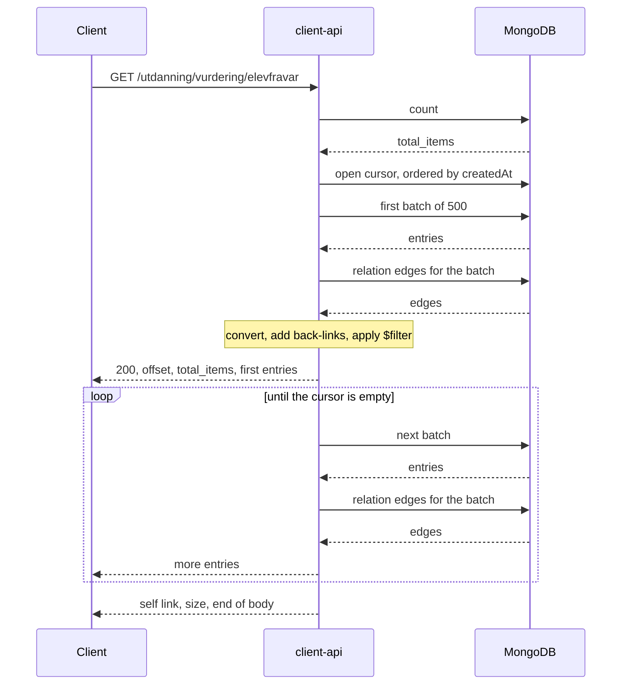

# List reads

A list read is `GET /utdanning/vurdering/elevfravar`, or the same with a `$filter` through `POST .../$query`. The
client-api answers it from the cache, which the adapters fill through syncs. There are two kinds, and the request
decides which one it gets.

| Kind    | Request                      | What the client gets                                                       |
|---------|------------------------------|----------------------------------------------------------------------------|
| A page  | `size` above zero            | `size` entries, with `self`, `prev` and `next` links to move through them. |
| A dump  | no `size`, or `size=0`       | Every entry of the collection, in one response.                            |

Both accept `sinceTimeStamp`, which keeps only the entries modified at or after it, and `$filter`, an OData
expression evaluated on each entry. Both come in the same shape:

```json
{
  "offset": 0,
  "total_items": 12345,
  "_embedded": { "_entries": [ ... ] },
  "_links": { "self": [ { "href": "..." } ] },
  "size": 12345
}
```

`total_items` is the collection count before `$filter`, `size` is how many entries the response holds.

## A page

One query reads `size + 1` entries through the `created_at_id` index, so every page is in `createdAt` order and the
extra entry says whether there is a `next`. A `cursor` in the link lets the next page start where this one ended
instead of skipping `offset` entries. The page's back-links come from one lookup of the relation edges that point
at the page's identifiers. Which relations get a back-link is listed in [RELATION_RULES.md](../RELATION_RULES.md). The page is built
in memory and returned as a body, which is fine: it is never bigger than `size`.

## A dump

A dump can be the whole collection, hundreds of thousands of entries. It is not built in memory. The client-api reads
it through a Mongo cursor in batches of 500 and writes each batch to the response as soon as it is ready. One batch
is in memory at a time, so a dump costs the same few megabytes whether the collection has 500 entries or 5 million.



The body goes out as `Transfer-Encoding: chunked`, since its length is not known when it starts. `offset` and
`total_items` lead because they are known when the dump opens. `size` closes the body because it is only known at
the end.

### Where the code is

| Step                                                   | Where                                                              |
|--------------------------------------------------------|--------------------------------------------------------------------|
| Decide page or dump                                    | `ResourceController.getResource` in client-api                     |
| Validate the filter, count, open the cursor            | `ResourceService.openDump`                                         |
| Read the cursor in batches                             | `ResourceStore.streamAll` in fint-core-shared                      |
| Convert a batch, merge its back-links, apply the filter | `ResourceService`, the same code a page uses                      |
| Write the batches to the response                      | `ResourceDumpWriter`                                               |
| Prune fields OPA did not allow, per entry              | `OpaFieldPruner`, shared with the advice that prunes returned bodies |
| Batch size                                             | `fint.consumer.list-read.batch-size`, default 500                  |

`ResourceService.openDump` returns a `ResourceDump`: the count, the offset, the self link and a lazy sequence of
batches. Nothing beyond the count is read until the writer pulls a batch. Closing the dump closes the cursor; the
controller does that in a `use` block.

### When something goes wrong

The writer reads the first batch, adds its back-links and runs the filter before it writes a byte. So the usual
failures still get a proper status:

| Failure                                                   | Status             |
|-----------------------------------------------------------|--------------------|
| `$filter` with bad syntax, or one that fails to evaluate  | 400                |
| Missing `x-org-id`                                        | 400                |
| Not allowed by the token or OPA                           | 401 or 403         |
| Mongo unreachable, cursor cannot open, first batch fails  | 500                |

Once the first batch is written the status is `200` and on the wire. If a later batch fails, say Mongo goes away
halfway, the status cannot change. The writer stops where it is. The `_entries` array is never closed, `_links` and
`size` never come, and nothing is appended, so the body does not parse as JSON. A client cannot take it for a
complete answer. Tomcat finishes the chunked encoding, so the client's read succeeds; the body is what gives the
failure away. The writer logs it at error level and counts it in `fint.client.list.stream.aborted`. The gauge
`fint.client.list.stream.active` shows how many dumps are in flight.

A client that disconnects mid-dump is not a failure. It is logged at debug and nothing is counted.

### Why it is built this way

Until October 2026 a dump loaded the whole collection, converted every entry, fetched every relation edge of the
type and, with OPA on, copied the whole response into a tree before Jackson wrote the first byte. A dump of
200,000 entries held one to two gigabytes of heap for its duration. The pod has one replica, a 4 Gi limit and exits
on OutOfMemoryError, so one oversized dump, or two at once, took the org's API down. Forcing clients to page would
have fixed it, but FINT clients pull full dumps by default and that contract could not change. Streaming keeps the
contract and the response shape and makes memory per request a function of the batch, not the collection.
